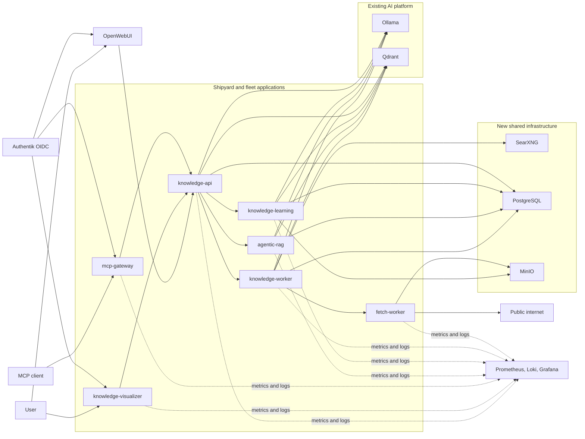
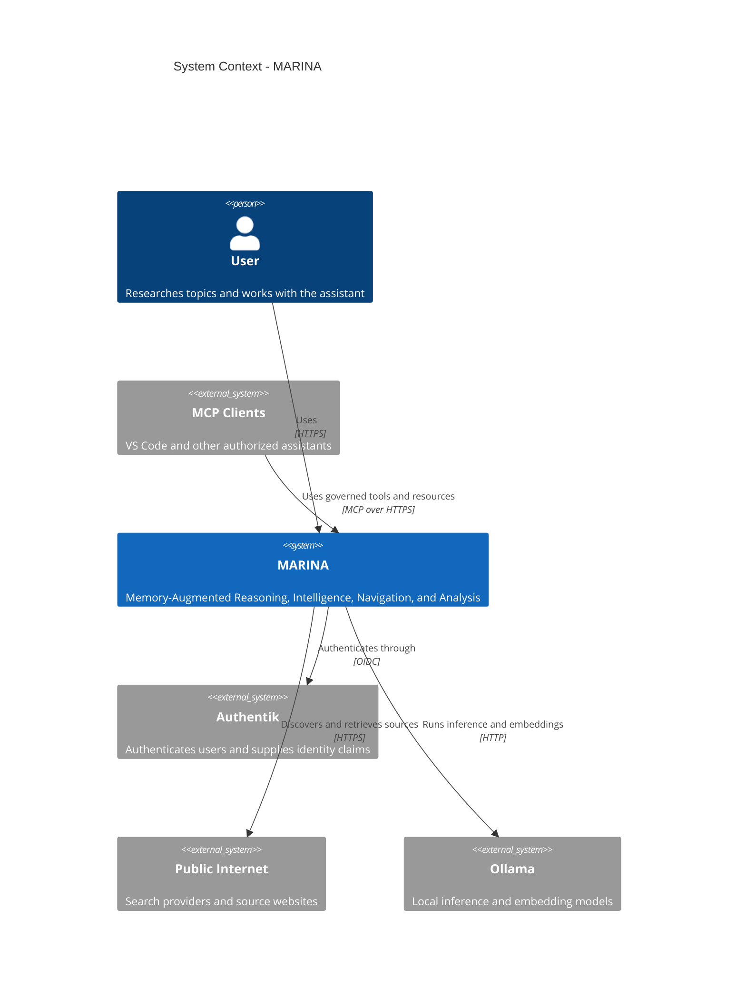
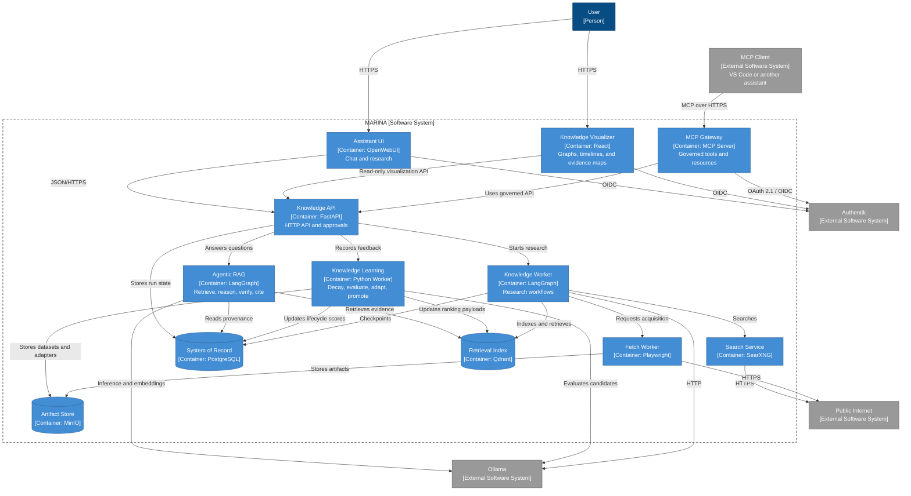
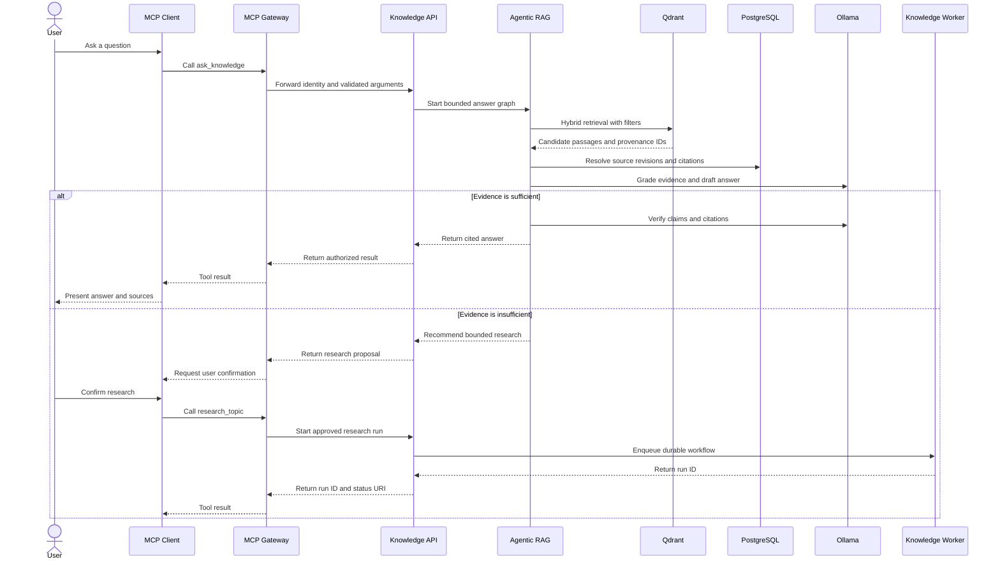
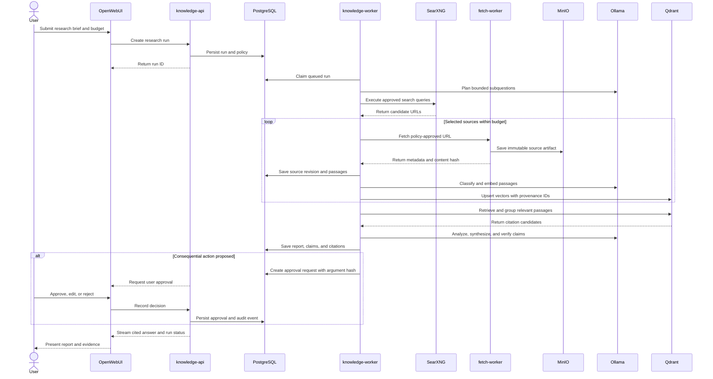
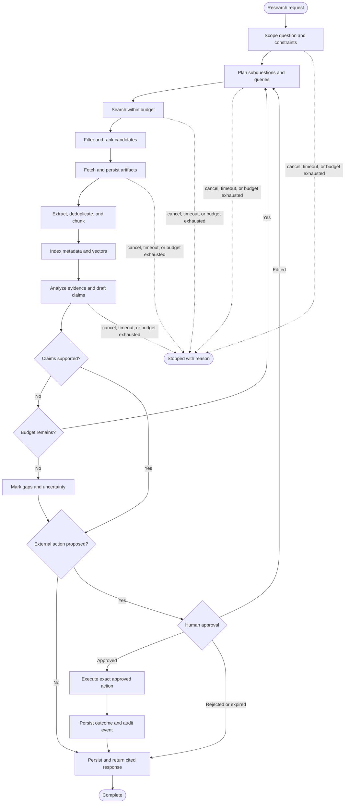
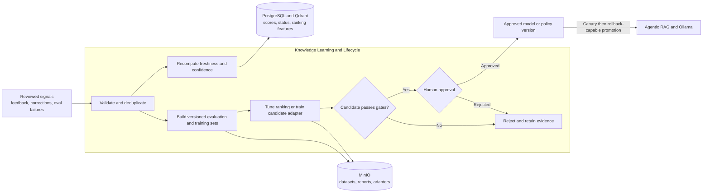
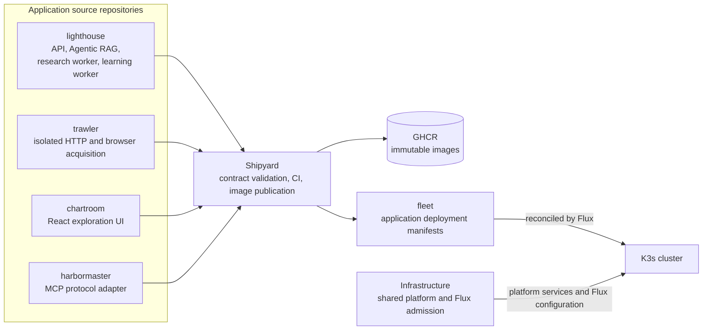

# MARINA

**Memory-Augmented Reasoning, Intelligence, Navigation, and Analysis**

> **Status:** Proposed architecture
> **System type:** Agentic knowledge system
> **Scope:** Internet discovery, evidence-preserving ingestion, knowledge
> retrieval, analysis, and a personal assistant running on the homelab.

## 1. Outcome

Build a private research assistant that can:

- turn a question or recurring topic into a bounded research plan;
- search the public web and ingest user-provided URLs and files;
- preserve the original source, extraction time, author, publication time, and
  content hash;
- normalize, deduplicate, classify, summarize, and link information;
- answer from the saved corpus with source-level and passage-level citations;
- detect changed sources and refresh only affected derived data;
- perform approved actions through a small, auditable tool registry; and
- pause for human approval before any consequential or external side effect.

This is not an autonomous general-purpose browser. It is a durable research
workflow with bounded agentic decisions inside deterministic controls.

## 2. Design Principles

1. **Evidence before synthesis.** Store fetched evidence before asking a model
   to interpret it. A generated claim must point to one or more saved passages.
2. **Raw data is immutable.** New fetches create source revisions. They never
   silently replace the evidence used by an earlier answer.
3. **The model is not the database.** PostgreSQL owns workflow and metadata,
   object storage owns source artifacts, and Qdrant owns retrieval indexes.
4. **Internet content is untrusted data.** Instructions found in a page cannot
   modify the agent policy or authorize tool calls.
5. **Agent autonomy is budgeted.** Every run has limits for searches, pages,
   tokens, elapsed time, and tool calls.
6. **Actions are least-privilege.** Read-only research tools are automatic;
   write, publish, execute, purchase, delete, and credential-bearing tools need
   explicit approval.
7. **Local first, replaceable parts.** Use Ollama, Qdrant, and OpenWebUI already
   present in the cluster. Keep model, search, extraction, and storage adapters
   behind stable interfaces.

## 3. Recommended Architecture



Standalone source: [agentic-knowledge-architecture.mmd](diagrams/agentic-knowledge-architecture.mmd)

### C4 System Context

The context view treats the complete solution as one system and shows only its
people and external dependencies.



Standalone source: [agentic-knowledge-context.mmd](diagrams/agentic-knowledge-context.mmd)

Flux deployment and observability are intentionally omitted here; those belong
in a separate C4 deployment view rather than the system context.

### C4 Containers

The container view shows independently running applications and data stores.
The ten functional modules are responsibilities implemented by these containers,
not ten separately deployable services. Mermaid's native C4 renderer has limited
layout control, so this view uses C4 notation and boundaries with an explicit
flowchart layout.



Standalone source: [agentic-knowledge-containers.mmd](diagrams/agentic-knowledge-containers.mmd)

### MCP to Agentic RAG



Standalone source: [agentic-rag-mcp-sequence.mmd](diagrams/agentic-rag-mcp-sequence.mmd)

| Layer | Component | Responsibility | Deployment owner |
| --- | --- | --- | --- |
| Experience | OpenWebUI | Conversation, authentication, saved chats, model selection | Infrastructure, existing |
| Visualization | `knowledge-visualizer` | Interactive knowledge graph, evidence map, timelines, topic exploration, source comparison, and run traces | Application repository through Shipyard/fleet |
| API | `knowledge-api` | Research, ask, source, collection, approval, and OpenAI-compatible endpoints | Application repository through Shipyard/fleet |
| MCP | `mcp-gateway` | Exposes authenticated knowledge resources and narrow tools without bypassing API policy | Application repository through Shipyard/fleet |
| Agentic RAG | `agentic-rag` | Query planning, hybrid retrieval, evidence grading, corrective retrieval, synthesis, and citation verification | Application repository through Shipyard/fleet |
| Learning and lifecycle | `knowledge-learning` | Knowledge confidence decay, feedback validation, retrieval tuning, evaluation datasets, candidate adapters, and governed promotion | Application repository through Shipyard/fleet |
| Orchestration | `knowledge-worker` | Durable LangGraph workflows, retries, budgets, checkpoints, and scheduled refresh | Application repository through Shipyard/fleet |
| Search | SearXNG | Private metasearch returning normalized JSON results | Infrastructure shared service |
| Acquisition | `fetch-worker` | HTTP fetch, robots/policy checks, MIME detection, Playwright fallback, malware/content limits | Application repository through Shipyard/fleet |
| Extraction | `knowledge-worker` | HTML readability extraction, PDF/text parsing, chunking, language detection, and metadata | Application repository through Shipyard/fleet |
| Models | Ollama | Planning, extraction assistance, embeddings, reranking, synthesis | Infrastructure, existing |
| Retrieval | Qdrant | Dense and sparse chunk vectors plus metadata filters | Infrastructure, existing |
| System of record | PostgreSQL | Jobs, graph checkpoints, sources, revisions, claims, citations, approvals, and audit events | Infrastructure shared service |
| Artifact store | MinIO | Immutable HTML, PDF, images, and normalized text keyed by content hash | Infrastructure shared service |
| Observability | Prometheus, Loki, Grafana | Metrics, logs, dashboards, alerts, and audit visibility | Infrastructure, existing |

Use one application image for `knowledge-api`, `agentic-rag`,
`knowledge-worker`, and `mcp-gateway`, selected by the container command. They
remain separate Kubernetes workloads so each has independent permissions,
resources, scaling, and network policy. Keep `fetch-worker` in a separate image
because a browser has a larger attack surface and different dependencies.

### Why these choices

- **LangGraph** supports explicit state graphs, persistence, durable execution,
  and human-in-the-loop interrupts. The workflow remains inspectable instead of
  becoming an unconstrained multi-agent conversation.
- **Agentic RAG** is a bounded query-time graph rather than a single retrieval
   prompt. It can rewrite a query, retrieve, grade evidence, retry with a strict
   iteration budget, synthesize, and reject unsupported claims.
- **MCP** provides a standard assistant integration surface. The gateway is an
   adapter over `knowledge-api`; it never receives direct PostgreSQL, Qdrant,
   MinIO, browser, shell, or Kubernetes access.
- **SearXNG** provides a self-hosted HTTP search API and avoids coupling the
  application to one search vendor. Paid search adapters can be added later.
- **Playwright** is only the fallback for JavaScript-rendered pages. Normal HTTP
  fetch plus deterministic extraction is faster and cheaper for most sources.
- **Qdrant** already runs in the cluster and supports hybrid dense/sparse
  retrieval with reciprocal rank fusion. Start with unweighted RRF and tune only
  after creating a relevance evaluation set.
- **PostgreSQL plus MinIO** separates transactional metadata from immutable
  artifacts. Qdrant can always be rebuilt from these stores.

## 4. Request and Ingestion Flow



Standalone source: [agentic-knowledge-research-sequence.mmd](diagrams/agentic-knowledge-research-sequence.mmd)

### Interactive research

1. The user submits a research brief, desired depth, allowed domains, freshness
   window, and budget.
2. The planner converts the brief into subquestions and search queries. The user
   can optionally approve the plan before acquisition.
3. SearXNG returns candidate URLs. A deterministic policy filters schemes,
   domains, duplicates, unsupported media, and private network addresses.
4. The fetch worker retrieves candidates with plain HTTP first and Playwright
   only when rendering is required.
5. Each response is hashed and stored as an immutable source revision in MinIO;
   metadata and fetch diagnostics are committed to PostgreSQL.
6. Deterministic parsers extract normalized text and structural anchors. The LLM
   may classify or summarize content but must not alter the captured evidence.
7. Content is deduplicated, chunked by document structure, embedded, and indexed
   in Qdrant. Each point contains stable source, revision, chunk, and tenant IDs.
8. The analyst retrieves evidence, identifies agreement and contradiction, and
   drafts claims. A critic checks citation coverage and unsupported statements.
9. The API returns an answer, source list, uncertainty notes, and a reproducible
   research-run ID. The completed report and its exact evidence set are saved.

### Continuous discovery

Saved monitors run on a schedule. Each monitor stores the topic, source policy,
cadence, and notification threshold. Conditional HTTP requests use ETag and
Last-Modified where available. A changed content hash creates a new revision,
re-indexes only changed chunks, and emits a diff summary. Notifications require
a meaningful-change threshold to avoid reporting navigation and advertising
changes.

## 5. Agent State Machine



Standalone source: [agentic-knowledge-state-machine.mmd](diagrams/agentic-knowledge-state-machine.mmd)

Use named states with typed inputs and outputs:

| State | Type | Exit condition |
| --- | --- | --- |
| `scope` | Agentic | A clear question, constraints, and success criteria exist |
| `plan` | Agentic | Subquestions and bounded queries are produced |
| `search` | Deterministic tool | Candidate URL budget is reached or queries are exhausted |
| `select` | Mixed | Candidates pass policy and relevance thresholds |
| `fetch` | Deterministic tool | Artifacts or explicit fetch failures are persisted |
| `extract` | Deterministic first | Normalized passages and anchors are persisted |
| `index` | Deterministic tool | PostgreSQL and Qdrant references agree |
| `analyze` | Agentic | Claims, contradictions, gaps, and confidence are recorded |
| `verify` | Mixed | Every material claim is cited or marked unsupported |
| `approve` | Human interrupt | A consequential action is approved, edited, or rejected |
| `respond` | Deterministic template plus LLM | Answer and run manifest are persisted |

Do not implement separate free-running planner, researcher, and critic agents.
Implement these roles as graph nodes sharing one typed run state. This reduces
cost, prevents recursive delegation, and makes retries idempotent.

### Agentic RAG Query Graph

The query-time RAG graph is separate from long-running internet research:

1. **Route:** decide whether the request can use saved knowledge, needs a new
   research run, or is outside the system's scope.
2. **Plan:** decompose complex questions and derive metadata filters.
3. **Retrieve:** run dense and sparse retrieval against Qdrant, grouped by source
   revision, then rerank a bounded candidate set.
4. **Grade:** test relevance, freshness, source diversity, and whether evidence
   can support the requested claims.
5. **Correct:** rewrite and retrieve again at most a configured number of times;
   optionally request a separate research run rather than browsing directly.
6. **Synthesize:** produce an answer only from selected passages.
7. **Verify:** resolve every citation, identify unsupported claims, and either
   revise the answer or expose uncertainty.

`agentic-rag` is read-oriented. It may enqueue research through
`knowledge-api`, but it cannot fetch arbitrary URLs, mutate the corpus, or invoke
external actions directly.

### Knowledge Learning and Lifecycle

`knowledge-learning` improves retrieval and model behavior through measured,
offline feedback loops. It does not perform uncontrolled online reinforcement
learning and never trains directly on unreviewed conversations.

The knowledge lifecycle score is computed from independent, inspectable factors:

$$
S = S_0 e^{-\lambda t} \cdot q \cdot c \cdot u
$$

where $S_0$ is the verified base confidence, $t$ is age, $\lambda$ is a
domain-specific decay rate, $q$ is source quality, $c$ is corroboration, and $u$
is measured usefulness. Legal, historical, and immutable facts can use
$\lambda=0$; volatile operational or product facts decay faster. A newer
verified revision, corroborating evidence, or successful revalidation raises the
score. Decay changes ranking and status, never immutable source artifacts or old
report citations.

Knowledge states are `active`, `aging`, `stale`, `disputed`, and `superseded`.
Crossing a threshold creates a refresh task or warning; it does not silently
delete evidence. Contradictory sources reduce claim confidence and remain visible
for review.

The reinforcement loop applies signals in increasing order of risk:

1. explicit answer ratings, citation corrections, and approved edits;
2. evaluation failures and retrieval relevance judgments;
3. tuned retrieval fusion, reranking, and routing policies;
4. curated supervised or preference datasets;
5. optional candidate LoRA adapters evaluated against a frozen holdout set;
6. human-approved canary promotion with an immediate rollback target.



Standalone source: [agentic-knowledge-learning-loop.mmd](diagrams/agentic-knowledge-learning-loop.mmd)

Promotion gates compare the candidate with the current production version on
retrieval recall, citation precision, unsupported-claim rate, task quality,
latency, resource use, safety cases, and regression suites. Feedback is weighted
by provenance and reviewer trust; raw popularity cannot override verified
evidence.

## 6. Knowledge Model

PostgreSQL is authoritative for identity and lineage:

| Entity | Important fields |
| --- | --- |
| `collection` | `id`, `owner_id`, `name`, `retention_policy` |
| `source` | `id`, canonical URL, domain, title, author, discovered time |
| `source_revision` | `id`, `source_id`, fetched time, published time, content hash, MIME type, HTTP metadata, artifact key, parser version |
| `passage` | `id`, `revision_id`, ordinal, heading path, character offsets, text hash |
| `claim` | `id`, normalized statement, confidence, status, created by run |
| `citation` | `claim_id`, `passage_id`, quote, support type |
| `entity` | `id`, type, canonical name, aliases |
| `relation` | subject, predicate, object, supporting claim |
| `research_run` | prompt, graph version, model IDs, budgets, status, timestamps |
| `approval` | run, proposed action, arguments hash, decision, actor, time |
| `audit_event` | actor, action, target, redacted arguments, outcome, trace ID |
| `feedback_event` | actor, target answer/claim/citation, rating, correction, review status, time |
| `lifecycle_score` | subject ID, score, state, decay policy, factors, computed time |
| `dataset_version` | purpose, immutable manifest, included signal IDs, exclusions, split hashes |
| `model_candidate` | base model, adapter artifact, dataset, metrics, status, approval, rollback target |

Qdrant stores one point per passage with named `dense` and `sparse` vectors. Its
payload contains IDs and filterable metadata, not the only copy of source text.
Initial retrieval should:

1. apply collection, owner, language, date, and source-quality filters;
2. prefetch dense and sparse candidates;
3. fuse them with default RRF;
4. group by `source_revision_id` to avoid one document dominating results;
5. rerank a small candidate set with a local cross-encoder when latency permits;
6. return passage anchors for citation rendering.

Represent the knowledge graph in PostgreSQL first. A dedicated graph database is
not justified until multi-hop graph traversal is measured as a bottleneck.

## 7. Assistant Interfaces

The API should expose:

| Endpoint | Purpose |
| --- | --- |
| `POST /v1/research-runs` | Start bounded research from a brief |
| `GET /v1/research-runs/{id}` | Stream or poll graph state and evidence |
| `POST /v1/ask` | Answer against selected collections with citations |
| `POST /v1/sources` | Ingest a URL or uploaded document |
| `GET /v1/sources/{id}/revisions` | Inspect provenance and changes |
| `POST /v1/monitors` | Schedule recurring discovery |
| `POST /v1/approvals/{id}` | Approve, edit, or reject a pending action |
| `POST /v1/feedback` | Record answer, claim, citation, or retrieval feedback for review |
| `GET /v1/knowledge/{id}/lifecycle` | Inspect confidence, freshness, decay factors, and refresh status |
| `GET /v1/learning/candidates` | List authorized model or retrieval-policy candidates and evaluations |
| `POST /v1/learning/candidates/{id}/promotion` | Propose approval-gated canary promotion or rollback |
| `GET /v1/visualizations/graph` | Return an authorized entity, claim, and relation subgraph |
| `GET /v1/visualizations/timeline` | Return source publication, revision, and research events |
| `GET /v1/visualizations/evidence` | Return claims with supporting, conflicting, and missing evidence |
| `GET /v1/visualizations/topics` | Return topic clusters and source distribution summaries |
| `GET /v1/visualizations/runs/{id}` | Return an authorized research-run trace and outcomes |
| `GET /healthz` and `GET /ready` | Kubernetes probes |
| `/v1/chat/completions` | OpenAI-compatible adapter for OpenWebUI |

### Knowledge Visualization

`knowledge-visualizer` is a separate read-only web application for exploring the
saved corpus and agent outcomes. Its initial views are:

- **knowledge graph:** entities, claims, relations, and supporting sources;
- **evidence map:** claims linked to supporting, conflicting, or missing passages;
- **research timeline:** publication, ingestion, revision, and contradiction events;
- **topic explorer:** clusters, related concepts, and source distribution;
- **source comparison:** agreement, disagreement, freshness, and confidence;
- **run trace:** agent states, tool outcomes, budgets, approvals, and citations.

Use React and TypeScript for the application, Cytoscape.js for graph interaction,
Apache ECharts for charts and timelines, and ELK.js for larger graph layouts.
The server returns bounded, presentation-ready DTOs with stable IDs and cursors;
the browser does not receive arbitrary SQL, Qdrant queries, hidden chain-of-thought,
credentials, or evidence outside the caller's authorized collections.

The visualizer authenticates through Authentik and calls only
`knowledge-api`. It never connects directly to PostgreSQL, Qdrant, MinIO,
Ollama, the fetch worker, or the MCP gateway. Large graph requests require node,
edge, time-range, and depth limits to prevent expensive unbounded traversals.

The MCP gateway exposes the stable API through a deliberately small surface:

| MCP primitive | Name | Behavior |
| --- | --- | --- |
| Tool | `ask_knowledge` | Run Agentic RAG over authorized collections |
| Tool | `research_topic` | Start a bounded, durable research run |
| Tool | `ingest_url` | Propose URL ingestion after server-side policy checks |
| Tool | `get_research_status` | Read progress and evidence for one run |
| Tool | `list_pending_approvals` | List approvals visible to the caller |
| Tool | `decide_approval` | Approve or reject the exact proposed argument hash |
| Resource | `knowledge://sources/{id}` | Read source metadata and revisions |
| Resource | `knowledge://reports/{id}` | Read a persisted cited report |

Do not expose generic SQL, vector search payloads, filesystem access, arbitrary
HTTP fetch, shell execution, or Kubernetes operations through MCP. Authenticate
remote MCP sessions, bind identity to every call, enforce collection-level
authorization in `knowledge-api`, validate arguments with JSON Schema, and emit
the same audit events as HTTP requests.

Memory is separated into:

- **conversation memory:** recent messages scoped to one chat;
- **profile memory:** user-approved preferences and standing instructions;
- **knowledge memory:** cited source material and derived claims;
- **operational memory:** run state, approvals, and tool outcomes.

Never infer permanent profile memory merely because something appeared in a
conversation. Promote it only through an explicit user action.

## 8. Security and Governance

### Prompt-injection boundary

- Label all fetched text as untrusted evidence in model messages.
- Never concatenate web text into system or developer instructions.
- Tool permissions come from server policy, not model output.
- Validate tool arguments against JSON Schema and re-check authorization after
  the model proposes a call.
- Block link-local, loopback, cluster, RFC1918, metadata-service, and non-HTTP(S)
  targets to prevent SSRF. Resolve DNS again at connection time.
- Run Playwright rootless with a read-only filesystem, temporary storage, no
  service-account token, and strict CPU, memory, response-size, and time limits.

### Action classes

| Class | Examples | Policy |
| --- | --- | --- |
| Read | Search, fetch public page, query saved knowledge | Automatic within budget |
| Draft | Prepare note, email, issue, or deployment proposal | Automatic, no external effect |
| Reversible write | Save monitor, tag source, create private note | User-configurable approval |
| External or privileged | Send message, publish, mutate Git, run shell, alter cluster | Mandatory one-time approval |
| Destructive or financial | Delete data, purchase, rotate credentials | Mandatory approval plus typed confirmation |

Store secrets only through the existing local secret workflow. Give each
integration a distinct credential and scope. Redact credentials, cookies,
authorization headers, and sensitive tool arguments from logs.

Respect robots directives, publisher terms, rate limits, copyright, and deletion
requests. Store only what is needed; make retention configurable per collection.

## 9. Homelab Deployment Boundaries

The current cluster already supplies Ollama, Qdrant, OpenWebUI, Traefik,
Authentik, Flux, Prometheus, Loki, and Grafana. Do not replace them.

### Repository Grouping

Use four new application repositories. Repository boundaries follow shared code,
release cadence, language toolchain, and security isolation rather than creating
one repository for every runtime container. Repository and image names use the
same nautical vocabulary as `fleet` and `shipyard`; runtime process names remain
technical so Kubernetes operations stay obvious.

| Repository | Owns | Images and runtime processes | Why separate |
| --- | --- | --- | --- |
| `lighthouse` | Domain model, migrations, API schemas, Agentic RAG graphs, research workflows, learning/decay logic, evaluations, connector interfaces | One `lighthouse` image running as `knowledge-api`, `agentic-rag`, `knowledge-worker`, or `knowledge-learning` | The core guides discovery and answers; its processes share Python types, persistence contracts, prompts, and tests and must evolve atomically |
| `trawler` | URL policy, SSRF defenses, HTTP client, Playwright acquisition, MIME limits, extraction sandbox | One `trawler` image running as `fetch-worker` | It gathers source material; browser dependencies and hostile content require a narrow trust boundary and independent patch cadence |
| `chartroom` | React UI, graph layouts, evidence maps, timelines, source comparison, run traces | One `chartroom` image running as `knowledge-visualizer` | It turns knowledge into navigable charts; the frontend has an independent toolchain and consumes only `knowledge-api` |
| `harbormaster` | MCP protocol, OAuth/OIDC session handling, tool/resource schemas, API client, protocol conformance tests | One `harbormaster` image running as `mcp-gateway` | It governs external assistant access and has narrow permissions plus an independent compatibility/security cadence |

The existing repositories retain these responsibilities:

| Repository | Responsibility |
| --- | --- |
| `fleet` | Production Kustomize manifests and immutable image promotion for the four applications |
| `Infrastructure` | Shared PostgreSQL, MinIO, and SearXNG services; existing Ollama, Qdrant, OpenWebUI, Authentik, ingress, observability, and Flux admission |
| `shipyard` | Contract schema, eligibility validation, reusable CI, image publication, and supply-chain evidence |



Standalone source: [agentic-knowledge-repositories.mmd](diagrams/agentic-knowledge-repositories.mmd)

One repository does not imply one pod. The `lighthouse` image has four
explicit commands and four Kubernetes workloads so API, RAG, background research,
and learning can scale and receive permissions independently. Its suggested
layout is:

```text
lighthouse/
   src/knowledge/
      api/
      rag/
      research/
      learning/
      connectors/
      domain/
      persistence/
   migrations/
   evaluations/
   tests/
   Dockerfile
   docker-compose.yml
   shipyard.yaml
```

Keep low-risk import and notification adapters behind interfaces in
`lighthouse/src/knowledge/connectors/` initially. Split a connector into its
own repository only when it needs independent credentials, dependencies,
ownership, or release cadence.

Application manifests belong in the `fleet` repository and enter through the
Shipyard eligibility pipeline. Infrastructure should add only shared PostgreSQL,
MinIO, and SearXNG services if they are not already supplied elsewhere. The former Infrastructure RAG placeholder has been retired now that `lighthouse`
is admitted through Fleet. Keep application deployments in Fleet rather than
reintroducing an Infrastructure-owned RAG deployment.

Recommended placement:

- namespaces: `marina-core`, `marina-fetch`, `marina-ui`, and `marina-mcp` so
   API, hostile-content acquisition, browser UI, and protocol edge permissions
   can be isolated independently;
- soft preference: `node-role/workloads=true` for application services;
- GPU inference: existing `ollama-win` service;
- public ingress: OpenWebUI and `knowledge-visualizer`, both protected by
   Authentik; expose `mcp-gateway` only when authenticated remote MCP is enabled;
- internal only: PostgreSQL, MinIO, Qdrant, SearXNG, learning and research
   workers, and browser worker;
- authentication: OpenWebUI via existing Authentik OIDC; propagate a verified
  user identity to `knowledge-api` with short-lived service credentials;
- persistence: local-path initially, with documented backups before production;
- egress: only the fetch worker and SearXNG need broad internet access.

The current `ai` NetworkPolicies control ingress only and are not enforced by
the default Flannel CNI. Treat egress isolation as an unmet prerequisite until a
NetworkPolicy-capable CNI is deployed. Application-layer SSRF controls are still
mandatory and cannot be delegated solely to the CNI.

## 10. Observability and Evaluation

Record a trace ID across API, graph nodes, model calls, fetches, and citations.
Expose at least:

- research runs by status and duration;
- search, fetch, extraction, and parse failure rates;
- pages, bytes, model tokens, and elapsed time per run;
- citation coverage and unsupported-claim rate;
- retrieval latency, recall at K, and reranker latency;
- source freshness and changed-source counts;
- lifecycle states, refresh queue age, accepted feedback, rejected feedback,
  candidate regressions, canary quality, and rollback counts;
- approvals requested, accepted, rejected, and expired;
- queue depth and oldest pending job age.

Maintain a versioned evaluation set with questions, relevant passages, and
expected answer facts. Gate releases on retrieval recall, citation precision,
unsupported-claim rate, and latency budgets. Do not tune retrieval weights on
the same examples used for final evaluation.

## 11. Delivery Plan

### Phase 0: Walking skeleton

- Create the `lighthouse` repository with FastAPI, PostgreSQL migrations, typed
   domain models, health endpoints, and Shipyard contract.
- Accept one URL, fetch static HTML, extract text, save source metadata, embed
  passages through Ollama, and index them in Qdrant.
- Implement `/v1/ask` with passage citations.
- Validate one end-to-end question against a fixed local fixture.

**Exit:** one saved URL can be queried after restart and every answer sentence
that asserts a fact has a resolvable passage citation.

### Phase 1: Internet discovery

- Add SearXNG and bounded query planning.
- Add URL canonicalization, deduplication, retries, robots handling, conditional
  requests, PDF parsing, and immutable artifacts.
- Add Playwright fallback in the isolated fetch worker.
- Add per-run budgets and cancellation.

**Exit:** a research brief produces a persisted report from multiple sources,
including explicit fetch failures and provenance.

### Phase 2: Reliable agent workflow

- Implement the typed LangGraph state machine and PostgreSQL checkpoints.
- Add contradiction detection, citation verification, and human interrupts.
- Add OpenWebUI's OpenAI-compatible integration and Authentik identity mapping.
- Add the Agentic RAG graph with retrieval grading, corrective retrieval, and
   citation verification.
- Add audit events and Grafana dashboards.

**Exit:** interrupted runs resume after worker restart; proposed external actions
cannot execute without a valid approval record.

### Phase 2.5: MCP integration

- Add the `mcp-gateway` runtime in `harbormaster` with `ask_knowledge`,
  `research_topic`, source/report resources, run status, and approval tools.
- Authenticate MCP clients and propagate caller identity to `knowledge-api`.
- Add protocol conformance, authorization, schema-validation, and audit tests.
- Verify that MCP has no direct data-store, fetcher, shell, or cluster access.

**Exit:** an MCP client can query saved knowledge and start a bounded research
run, while unauthorized collections and unapproved consequential actions remain
inaccessible.

### Phase 3: Continuous knowledge

- Add scheduled monitors, source revision diffs, selective re-indexing, and
  notifications.
- Add hybrid retrieval and a measured reranker.
- Add profile memory promotion and retention/deletion workflows.
- Add backup and restore tests for PostgreSQL, MinIO, and Qdrant rebuilds.

**Exit:** changed sources update the corpus without losing old evidence, and a
Qdrant loss can be recovered from PostgreSQL plus MinIO.

### Phase 4: Knowledge visualization

- Add the `knowledge-visualizer` runtime in `chartroom` with graph, evidence,
  timeline, topic, comparison, and research-run views.
- Add bounded visualization DTO endpoints to `knowledge-api` with collection-level
   authorization, pagination, and stable identifiers.
- Add Authentik OIDC, responsive layouts, keyboard navigation, and accessible
   non-graph alternatives for essential information.
- Add browser tests for tenant isolation, citation navigation, large-graph
   limits, empty states, and research-run trace rendering.

**Exit:** a user can move from a claim to its evidence and source revision,
compare conflicting sources, and inspect a research run without direct access to
any backing store.

### Phase 5: Learning and decay

- Add domain-specific decay policies, scheduled score recomputation, stale-data
   warnings, and refresh task creation.
- Add reviewed feedback capture with provenance, deduplication, abuse controls,
   and correction workflows.
- Tune retrieval and reranking policies against versioned train/validation/test
   splits before attempting model adaptation.
- Add versioned dataset manifests and optional LoRA candidate training jobs.
- Add evaluation gates, approval records, canary deployment, rollback, and model
   or policy lineage dashboards.

**Exit:** stale knowledge is demoted without losing evidence; a candidate cannot
reach production without outperforming the current version on frozen gates,
receiving approval, and retaining a tested rollback path.

## 12. Initial Acceptance Tests

1. A page containing prompt-injection text cannot cause a tool call or alter the
   run policy.
2. A URL resolving to a private or cluster address is rejected before fetch and
   after DNS resolution.
3. Re-ingesting unchanged content creates no duplicate passages or embeddings.
4. Changed content creates a new revision while an old report keeps resolving to
   its original cited passage.
5. Killing a worker mid-run allows the workflow to resume without repeating a
   committed side effect.
6. An answer with an uncited material claim fails verification or labels the
   claim as unsupported.
7. A write-capable tool call remains pending until an authorized user approves
   the exact argument hash.
8. Qdrant can be cleared and rebuilt from the authoritative stores.
9. User A cannot retrieve User B's collections, source text, run state, or
   approvals.
10. Every run stops at its configured search, page, token, time, and tool budget.
11. Visualization responses contain only authorized collections and remain
   bounded by configured node, edge, depth, and time-range limits.
12. Decay never mutates source artifacts or historical citations, and immutable
   facts configured with zero decay retain their score.
13. Unreviewed or poisoned feedback cannot enter a training dataset, and a model
   or retrieval-policy candidate cannot bypass evaluation, approval, canary, or
   rollback controls.

## 13. Decisions Deferred

- Select embedding and reranking models using the evaluation set and available
  GPU memory, not benchmark reputation alone.
- Add paid search APIs only if SearXNG recall or reliability is insufficient.
- Add OCR after scanned-document demand is demonstrated.
- Add a graph database only when measured queries require graph-native traversal.
- Add outbound email, calendar, GitHub, or cluster tools one at a time, each with
  its own schema, credential, policy, tests, and approval mode.
- Move artifacts to NFS or replicated object storage only after backup and node
  failure requirements are defined.

## 14. Upstream References

- [LangGraph overview](https://docs.langchain.com/oss/python/langgraph/overview)
- [SearXNG Search API](https://docs.searxng.org/dev/search_api.html)
- [Qdrant hybrid and multi-stage queries](https://qdrant.tech/documentation/concepts/hybrid-queries/)
- [Playwright for Python](https://playwright.dev/python/docs/intro)
